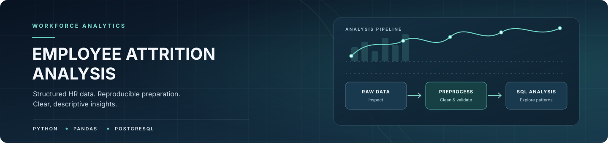
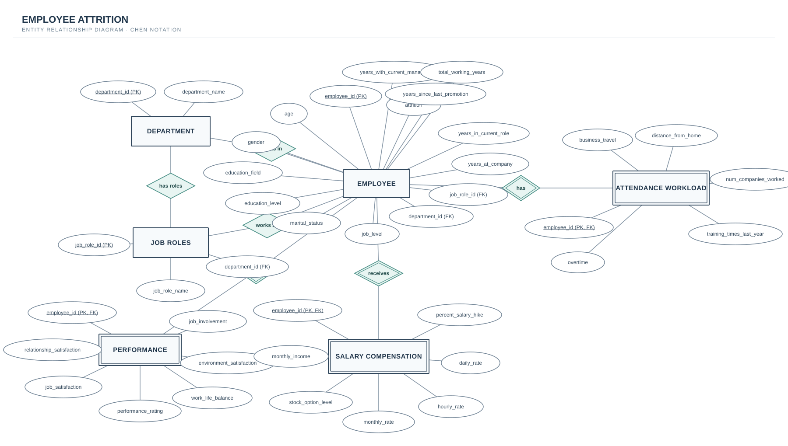

<p align="center">
  
</p>

<p align="center"><strong>Workforce data. Reproducible preparation. Clear, descriptive insights.</strong></p>

## Overview

Employee Attrition Analysis explores how employee attrition varies across departments, job roles, compensation, overtime, satisfaction, marital status, and tenure. The project combines Python and Pandas for initial data understanding and cleaning with PostgreSQL for relational data design and descriptive analysis.

The results describe patterns in the available dataset. They do not establish causation or provide a validated prediction of future employee departures.

## Current Project Scope

### Implemented

- **Data understanding and preprocessing:** Inspect the raw dataset, check missing values and duplicate records, verify employee identifiers, and remove three constant columns using Pandas.
- **Relational data design:** Organize employee information into related PostgreSQL tables.
- **Data loading and descriptive SQL analysis:** Load employee data into the relational structure and summarize attrition patterns across workforce characteristics.

### Future Work

Broader exploratory data analysis (EDA), feature engineering, and machine learning are potential next steps. They are not part of the current implemented scope.

## Dataset

| Item | Details |
|---|---|
| Raw file | `data/raw/employee_attrition_raw.csv` |
| Original size | 1,470 rows × 35 columns |
| One row represents | One employee |
| Target column | `Attrition` (`Yes` / `No`) |
| Processed file | `data/processed/employee_attrition_cleaned.csv` |

The preprocessing notebook checks data structure, missing values, duplicate records, and employee identifiers. It removes three constant columns: `EmployeeCount`, `Over18`, and `StandardHours`. The processed file retains all 1,470 rows and 32 columns. `EmployeeNumber` is retained as an identifier for record tracking and should be excluded from model features if machine learning is added later.

## Repository Structure

```text
employees-attrition/
├── README.md
├── assets/
│   ├── banner.svg
│   └── employee_attrition_erd.svg
├── data/
│   ├── raw/
│   │   └── employee_attrition_raw.csv
│   └── processed/
│       └── employee_attrition_cleaned.csv
├── notebooks/
│   └── 01_data_preprocessing.ipynb
└── sql/
    ├── schema.sql
    ├── data.sql
    └── queries.sql
```

## Preprocessing

Notebook: [`notebooks/01_data_preprocessing.ipynb`](notebooks/01_data_preprocessing.ipynb)

The notebook covers:

1. Loading the raw CSV into a Pandas DataFrame.
2. Inspecting the data with `head()`, `info()`, and `describe()`.
3. Checking missing values and duplicate rows.
4. Checking constant columns and the uniqueness of `EmployeeNumber` before deletion.
5. Removing the three constant columns that do not add useful variation.
6. Saving the cleaned dataset to `data/processed/employee_attrition_cleaned.csv`.

No rows are removed by the current cleaning step. Potential outliers should be reviewed in context rather than deleted automatically.

## Database Design

The SQL layer organizes the dataset into six related tables. Each table has a specific responsibility, while keys connect related records for analysis.

| Table | Purpose |
|---|---|
| `departments` | Stores department identifiers and names. |
| `job_roles` | Stores job-role identifiers, names, and their associated departments. |
| `employees` | Stores employee demographics, employment details, job assignment, tenure, and attrition status. |
| `salary_compensation` | Stores employee income, pay rates, salary-hike percentage, and stock-option level. |
| `performance` | Stores employee satisfaction, performance ratings, and work-life balance measures. |
| `attendance_workload` | Stores overtime, business travel, commuting distance, previous employment count, and training information. |

### Entity Relationship Diagram

The diagram is displayed below for immediate review. It uses Chen-style entities, attributes, and relationship diamonds.

<p align="center">
  
</p>

## Descriptive Analysis

The SQL scripts contain descriptive queries for examining attrition rates and comparing groups across department, job role, overtime, compensation, satisfaction, marital status, income range, and tenure. The analysis is exploratory: differences between groups may indicate patterns worth investigating, but they do not prove causation.

A useful metric is the attrition rate:

```text
Attrition Rate (%) = (Employees with Attrition = Yes / Total Employees in the group) × 100
```

Counts and rates should be considered together because group sizes differ.

## Run Locally

### Requirements

- PostgreSQL installed and running
- Python with Pandas and Jupyter Notebook to run the preprocessing notebook
- The raw CSV stored at `data/raw/employee_attrition_raw.csv`

### 1. Clone the repository

```bash
git clone https://github.com/MSalama8/employees-attrition.git
cd employees-attrition
```

### 2. Run the preprocessing notebook

Open `notebooks/01_data_preprocessing.ipynb` in Jupyter Notebook or VS Code and run the cells in order. Ensure that the input and output paths match the repository structure.

### 3. Create a PostgreSQL database

```bash
createdb employee_attrition
```

### 4. Create the tables

```bash
psql -d employee_attrition -f sql/schema.sql
```

### 5. Load the data

Before running `sql/data.sql`, update the `COPY` statement to use the absolute path to `data/raw/employee_attrition_raw.csv` on your machine. PostgreSQL's server-side `COPY` requires the database server to be able to access that path.

Then run:

```bash
psql -d employee_attrition -f sql/data.sql
```

For local files accessible to the `psql` client, `\\copy` is another option. The current loading script is intended for a fresh database; running it repeatedly without resetting the tables can cause duplicate-key errors or repeated staging data.

### 6. Run the SQL analysis

```bash
psql -d employee_attrition -f sql/queries.sql
```

Execution order:

```text
schema.sql → data.sql → queries.sql
```

## Interpretation Notes

- **Association is not causation.** Group differences can point to patterns worth investigating, but the queries do not prove that a characteristic causes employee attrition.
- **Rule-based filters are not predictions.** They do not provide a validated future risk score.
- **Compare counts and rates together.** Group sizes differ, so a high count does not necessarily mean a high attrition rate.
- **Currency is not specified.** Do not add a currency symbol to income values unless a reliable source confirms the unit.

## Team

- [Mohamed Sakr](https://github.com/SakrrDev) — Project Owner
- [Mohamed Salama](https://github.com/MSalama8) — Contributor
- [Goda](https://github.com/Godas2) — Contributor
- [Ali Jabr](https://github.com/agabr7726-sketch) — Contributor
- [Mostafa Nabil](https://github.com/MostafaNabill1) — Contributor
- [Abdelrahman](https://github.com/Bodika-dev) — Contributor
