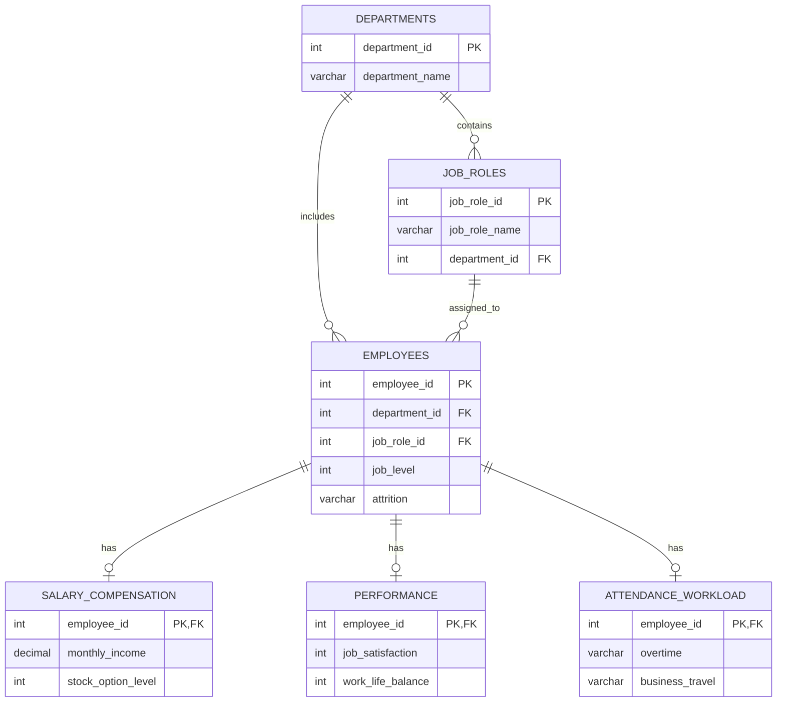

<div align="center">
  
  <br />
  <p><strong>Understanding workforce attrition through structured HR data and SQL-driven analysis.</strong></p>
  <p>
    
    
    
    
  </p>
</div>

---

## Overview

**Employee Attrition Analysis** is a team data analytics project focused on exploring employee turnover patterns in HR data. The project organizes employee information in a relational database and uses SQL to investigate how attrition varies across departments, job roles, compensation, overtime, satisfaction, and other workforce attributes.

The goal is to turn raw employee data into clear, interpretable insights that can support further investigation—not to assume that a correlation proves a cause or that a descriptive query predicts future departures.

## Key Questions

This project explores questions such as:

| Area | Question |
|---|---|
| Overall attrition | What proportion of employees left the organization in the dataset? |
| Departments & roles | How do attrition counts and rates differ across departments and job roles? |
| Workload | How does attrition compare between employees who work overtime and those who do not? |
| Compensation | How do monthly income and stock-option levels relate to observed attrition? |
| Employee experience | How do job satisfaction and work-life balance differ by attrition status? |
| Workforce profile | How does attrition vary by marital status and income bracket? |
| Tenure | How do department headcount and average years at the company compare? |

## Dataset

The project uses the **IBM HR Analytics Employee Attrition & Performance** dataset, distributed publicly through Kaggle.

| Item | Details |
|---|---|
| Source file | `WA_Fn-UseC_-HR-Employee-Attrition.csv` |
| Commonly reported size | 1,470 records × 35 columns |
| Record represents | One employee |
| Analysis target | `Attrition` (`Yes` / `No`) |
| Source | [IBM HR Analytics dataset on Kaggle](https://www.kaggle.com/datasets/pavansubhasht/ibm-hr-analytics-attrition-dataset) |

> **Data note:** This is a fictional HR analytics dataset, not a record of IBM's actual employees. The data does not include employee departure dates; therefore, it cannot establish when departures occurred or support time-based attrition trends on its own.

## Database Design

The SQL schema separates the data into six related tables. This keeps employee details, organizational information, compensation, performance, and workload attributes organized while allowing related records to be joined for analysis.

<div align="center">

| Table | What it stores |
|:---|:---|
| `departments` | Department identifiers and names |
| `job_roles` | Job-role identifiers, names, and associated departments |
| `employees` | Employee demographics, employment history, department, role, and attrition status |
| `salary_compensation` | Income, rates, salary-hike percentage, and stock-option level |
| `performance` | Job satisfaction, performance rating, work environment, relationships, and work-life balance |
| `attendance_workload` | Overtime, business travel, distance from home, previous companies, and training |

</div>

### Entity Relationship Diagram



## SQL Analysis

The business queries are maintained in [`sql/queries.sql`](sql/queries.sql). They answer the following questions:

<details>
  <summary><strong>View all 10 SQL business questions</strong></summary>

  1. What is the overall employee attrition rate?
  2. Which departments have the highest attrition rates?
  3. How does attrition vary by job role?
  4. How does attrition compare by overtime status?
  5. How does average monthly income differ between employees who left and those who stayed?
  6. How do job satisfaction and work-life balance compare by attrition status?
  7. How does attrition vary by marital status?
  8. How does attrition vary across monthly-income brackets?
  9. Which current employees match the exploratory rule of working overtime and having a stock-option level of `0`?
  10. How do department headcount and average tenure compare?

</details>

### Metric Definition

The attrition rate for a group is calculated as:

`Attrition Rate (%) = (Employees with Attrition = Yes / Total Employees in the group) × 100`

Counts and rates should be interpreted together: a group with more employees may have a higher number of departures while having a lower attrition rate.

## Repository Layout

```text
employees-attrition/
├── README.md
└── sql/
    ├── schemas.sql   # Defines tables and relationships
    ├── data.sql      # Loads the CSV into a staging table and populates analysis tables
    └── queries.sql   # Contains SQL business questions
```

## Tools

<p>
  
  
  
  
</p>

## Run Locally

### Requirements

- PostgreSQL installed and running
- The source CSV file downloaded locally
- A PostgreSQL user permitted to create tables and load data

### 1. Clone the repository

```bash
git clone https://github.com/MSalama8/employees-attrition.git
cd employees-attrition
```

### 2. Create a database

```bash
createdb employee_attrition
```

### 3. Create the tables

```bash
psql -d employee_attrition -f sql/schemas.sql
```

### 4. Load the data

Before running `sql/data.sql`, update the CSV file path in the script to match your environment. Then run:

```bash
psql -d employee_attrition -f sql/data.sql
```

The script currently uses PostgreSQL's server-side `COPY` command. The database server must be able to access the CSV at the specified path. When using `psql`, client-side `\copy` is another option if the file is accessible from your local machine.

### 5. Execute the analysis queries

```bash
psql -d employee_attrition -f sql/queries.sql
```

**Execution order:** `schemas.sql` → `data.sql` → `queries.sql`

> **Important:** The current data-loading script is intended for a fresh database. Running it again without resetting the tables can cause duplicate-key errors or duplicated rows in the staging table.

## Interpretation Notes

- **Association is not causation.** Group differences can point to patterns worth investigating, but these queries do not prove that a characteristic causes employee attrition.
- **Question 9 is a rule-based filter, not a prediction.** It lists current employees who match the selected conditions; it does not calculate a validated future risk score.
- **Compare counts and rates together.** Group sizes differ, so a high count does not necessarily mean a high attrition rate.
- **Currency is not specified.** Do not add a currency symbol to income values unless a reliable source confirms the unit.

## Team
<table align="center">
  <tr>
    <td align="center">
      <a href="https://github.com/SakrrDev">
        <br>
        <b>@Mohamed Sakr</b>
      </a><br>Project Owner
    </td>
    <td align="center">
      <a href="https://github.com/MSalama8">
        <br>
        <b>@Mohamed Salama</b>
      </a><br>Contributor
    </td>
    <td align="center">
      <a href="https://github.com/MostafaNabill1">
        <br>
        <b>@Mostafa Nabil</b>
      </a><br>Contributor
    </td>
    <td align="center">
      <a href="https://github.com/Godas2">
        <br>
        <b>@Goda</b>
      </a><br>Contributor
    </td>
    <td align="center">
      <a href="https://github.com/agabr7726-sketch">
        <br>
        <b>@Ali Jabr</b>
      </a><br>Contributor
    </td>
    <td align="center">
      <a href="https://github.com/Bodika-dev">
        <br>
        <b>@Abdelrahman</b>
      </a><br>Contributor
    </td>
  </tr>
</table>

---

<div align="center">
  <sub>Employee Attrition Analysis</sub>
</div>
