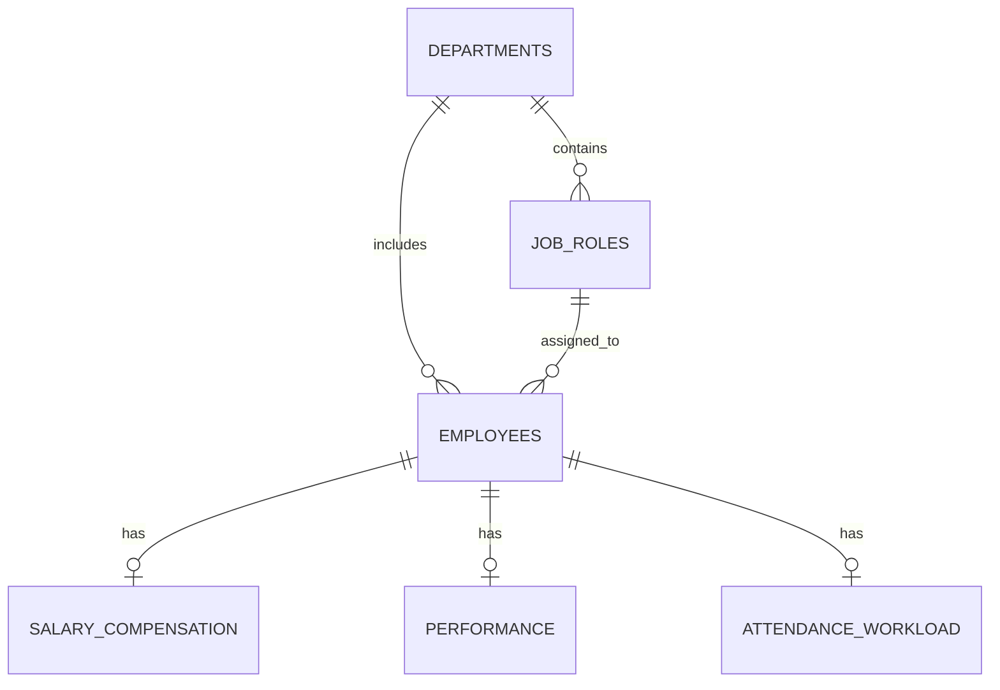

# Employee Attrition Analysis

A data analytics project that explores employee attrition patterns using Python, Pandas, and PostgreSQL. The workflow separates raw data, preprocessing, and SQL analysis so each stage can be reviewed and reproduced.

## Overview

The project examines how employee attrition varies across departments, job roles, compensation, overtime, satisfaction, marital status, and tenure. SQL is used to answer descriptive business questions, while the preprocessing notebook documents initial data checks and cleaning decisions.

The results describe patterns in this dataset. They do not establish causation or provide a validated prediction of future employee departures.

## Dataset

| Item | Details |
|---|---|
| Raw file | `data/raw/employee_attrition_raw.csv` |
| Original size | 1,470 rows × 35 columns |
| One row represents | One employee |
| Target column | `Attrition` (`Yes` / `No`) |
| Processed file | `data/processed/employee_attrition_cleaned.csv` |

The preprocessing notebook checks data structure, missing values, duplicate records, and employee identifiers. It removes three constant columns: `EmployeeCount`, `Over18`, and `StandardHours`. The processed file retains all 1,470 rows and 32 columns. `EmployeeNumber` is retained as an identifier for record tracking and should be excluded from model features if machine learning is added later.

## Repository Structure

```text
employees-attrition/
├── README.md
├── data/
│   ├── raw/
│   │   └── employee_attrition_raw.csv
│   └── processed/
│       └── employee_attrition_cleaned.csv
├── notebooks/
│   └── 01_data_preprocessing.ipynb
└── sql/
    ├── schema.sql
    ├── data.sql
    └── queries.sql
```

## Preprocessing

Notebook: [`notebooks/01_data_preprocessing.ipynb`](notebooks/01_data_preprocessing.ipynb)

The notebook covers:

1. Loading the raw CSV into a Pandas DataFrame.
2. Inspecting the data with `head()`, `info()`, and `describe()`.
3. Checking missing values and duplicate rows.
4. Checking constant columns and the uniqueness of `EmployeeNumber` before deletion.
5. Removing the three constant columns that do not add useful variation.
6. Saving the cleaned dataset to `data/processed/employee_attrition_cleaned.csv`.

No rows are removed by the current cleaning step. Potential outliers should be reviewed in context rather than deleted automatically.

## Database Design

The SQL layer organizes the dataset into six related tables.

| Table | Purpose |
|---|---|
| `departments` | Department identifiers and names |
| `job_roles` | Job-role names and their departments |
| `employees` | Employee demographics, tenure, role, and attrition status |
| `salary_compensation` | Income, pay rates, salary-hike percentage, and stock-option level |
| `performance` | Satisfaction, performance rating, and work-life balance measures |
| `attendance_workload` | Overtime, business travel, commuting distance, and training information |



## SQL Business Questions

The queries are maintained in [`sql/queries.sql`](sql/queries.sql). They investigate:

1. What is the overall employee attrition rate?
2. Which departments have the highest attrition rates?
3. How does attrition vary by job role?
4. How does attrition compare by overtime status?
5. How does average monthly income differ between employees who left and those who stayed?
6. How do job satisfaction and work-life balance compare by attrition status?
7. How does attrition vary by marital status?
8. How does attrition vary across monthly-income brackets?
9. Which current employees match the exploratory rule of working overtime and having a stock-option level of `0`?
10. How do department headcount and average tenure compare?

### Attrition Rate

For a group, the attrition rate is calculated as:

```text
Attrition Rate (%) = (Employees with Attrition = Yes / Total Employees in the group) × 100
```

Counts and rates should be considered together because group sizes differ.

## Run Locally

### Requirements

- PostgreSQL installed and running
- Python with Pandas and Jupyter Notebook to run the preprocessing notebook
- The raw CSV stored at `data/raw/employee_attrition_raw.csv`

### 1. Clone the repository

```bash
git clone https://github.com/MSalama8/employees-attrition.git
cd employees-attrition
```

### 2. Run the preprocessing notebook

Open `notebooks/01_data_preprocessing.ipynb` in Jupyter Notebook or VS Code and run the cells in order. If needed, adjust the CSV paths in the notebook to match the repository layout.

### 3. Create a PostgreSQL database

```bash
createdb employee_attrition
```

### 4. Create the tables

```bash
psql -d employee_attrition -f sql/schema.sql
```

### 5. Load the data

Before running `sql/data.sql`, update the `COPY` statement to use the absolute path to `data/raw/employee_attrition_raw.csv` on your machine. PostgreSQL's server-side `COPY` requires the database server to be able to access that path.

Then run:

```bash
psql -d employee_attrition -f sql/data.sql
```

For local files accessible to the `psql` client, `\\copy` is another option. The current loading script is intended for a fresh database; running it repeatedly without resetting the tables can cause duplicate-key errors or repeated staging data.

### 6. Run the analysis queries

```bash
psql -d employee_attrition -f sql/queries.sql
```

Execution order:

```text
schema.sql → data.sql → queries.sql
```

## Interpretation Notes

- **Association is not causation.** Group differences identify patterns to investigate; they do not prove that a characteristic causes attrition.
- **Question 9 is a rule-based filter, not a prediction.** It does not calculate a validated future risk score.
- **Compare counts and rates together.** A higher departure count does not necessarily mean a higher attrition rate.
- **Currency is unspecified.** Do not add a currency symbol unless the unit is confirmed from a reliable source.

## Interpretation Notes

- **Association is not causation.** Group differences can point to patterns worth investigating, but these queries do not prove that a characteristic causes employee attrition.
- **Question 9 is a rule-based filter, not a prediction.** It lists current employees who match the selected conditions; it does not calculate a validated future risk score.
- **Compare counts and rates together.** Group sizes differ, so a high count does not necessarily mean a high attrition rate.
- **Currency is not specified.** Do not add a currency symbol to income values unless a reliable source confirms the unit.

## Team

- [Mohamed Sakr](https://github.com/SakrrDev) — Project Owner
- [Mohamed Salama](https://github.com/MSalama8) — Contributor
- [Mostafa Nabil](https://github.com/MostafaNabill1) — Contributor
- [Goda](https://github.com/Godas2) — Contributor
- [Ali Jabr](https://github.com/agabr7726-sketch) — Contributor
- [Abdelrahman](https://github.com/Bodika-dev) — Contributor

---

Employee Attrition Analysis
